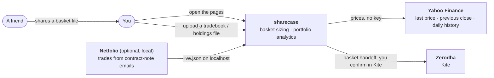
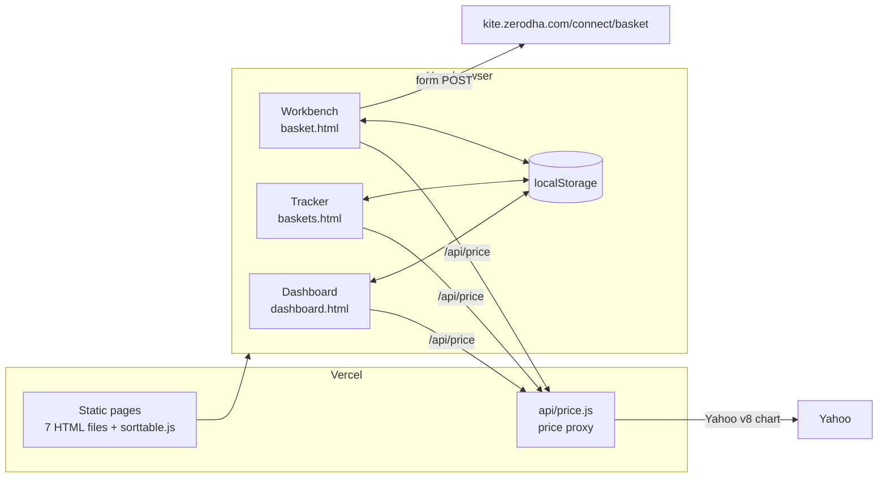
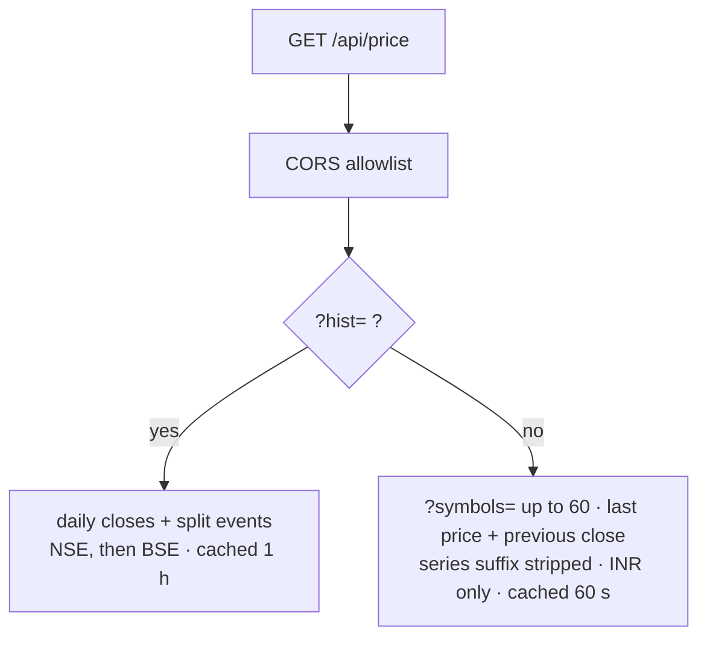
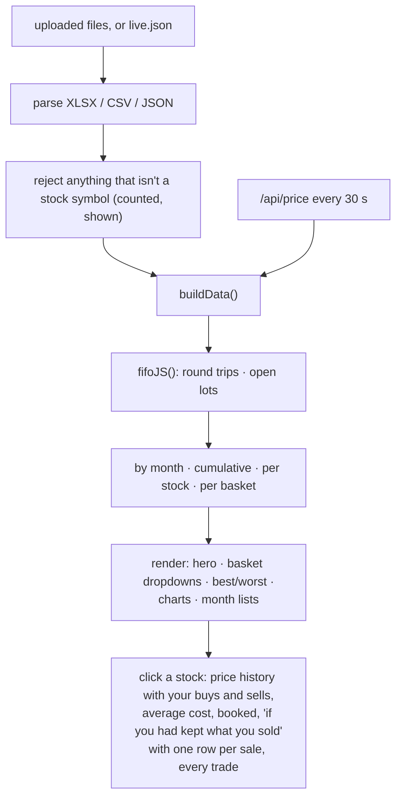

# How sharecase works

sharecase is a set of static HTML pages and one serverless function. It has no build step, database,
accounts or telemetry. Every number is calculated in your browser from files you give it, and the
server only fetches stock prices.

The pages get your trades in one of two ways:
- **On the public site,** from files you upload: a Console tradebook and a holdings file.
- **On your own machine,** from [Netfolio](https://github.com/udaysrinu/netfolio), which reads your
  broker's contract notes from Gmail and serves the result to these same pages on `localhost`.
  Nothing has to be downloaded or uploaded.

## 1. Context

## 2. Containers

| Page | What it does | Where its data comes from |
|---|---|---|
| `basket.html`, the Workbench | turns target weights into whole-share orders for an amount, or a rebalance of what you hold | a basket file, a pasted sheet, a holdings export |
| `baskets.html`, the Tracker | per-basket ledger: value, invested, open and booked profit | your basket file and trades, kept in localStorage |
| `dashboard.html` | whole-portfolio view: booked profit by month, best and worst stocks, per-stock history | an uploaded tradebook (XLSX/CSV) and/or holdings (JSON), or `live.json` when Netfolio serves one |
| `index`, `onboarding`, `friends`, `method` | landing page, Kite key setup, a guide, and the sizing method | none |

Every data table sorts by any column (`sorttable.js`). A redrawn table keeps the sort you chose.

What's kept in your browser (`localStorage`): the basket file, parsed trades, the "hide amounts"
switch, and your Kite **API key**. The key is public by design. These pages never use the API secret.

## 3. The price API

- Yahoo sends no CORS header, so a browser can't read it directly; this function can.
- It needs no key and holds no credentials.
- It returns a symbol as missing rather than guessing a price.

## 4. Inside the Dashboard

## 5. How the numbers are calculated

| Number | Rule |
|---|---|
| Booked (realised) profit | FIFO per symbol with **same-day netting**, the way Zerodha computes it. On a day with both buys and sells, the matched quantity is intraday at that day's average buy against average sell. Only the remainder sells the oldest lots, or opens one new lot. This reproduces Kite's average prices. |
| Average cost | the cost of the open FIFO lots |
| Open (unrealised) profit | quantity × (last price − average cost) |
| Session move | quantity × (last price − previous close), labelled "last session" outside market hours |
| Whole-share sizing | shares are whole, so a basket only hits its weights exactly at certain amounts. The Workbench lists the nearest exact amounts (see [method.html](../method.html)). |
| If you had kept what you sold | per sale: shares sold × splits since × today's price − what you received. The sheet totals what you received and what those shares are worth now. |

Every figure is gross: no brokerage, taxes or charges, and no dividends.

The pages and Netfolio's Python compute the same numbers independently. Netfolio's tests run the
pages' own JavaScript and require both to agree to the rupee.

## 6. Refresh

- **Prices:** automatic, every 30 seconds while a page is open.
- **Trades and holdings, on the public site:** whenever you load a new file. Kite's API only exposes
  today's orders, so trade history has to come from Console tradebook exports.
- **Trades and holdings, with Netfolio:** from the contract note your broker emails for every day you
  trade. Netfolio checks who signed each note and that its sums hold, then rebuilds `live.json`.
  The Dashboard re-reads it every 30 seconds.

## 7. Security
- Basket files come from other people, so they're untrusted.
  - Symbols are validated where data comes in: A–Z, 0–9 and `& . -` only.
  - Basket names and other free text are escaped wherever they're shown.
- The one CDN script (SheetJS) is pinned with Subresource Integrity.
