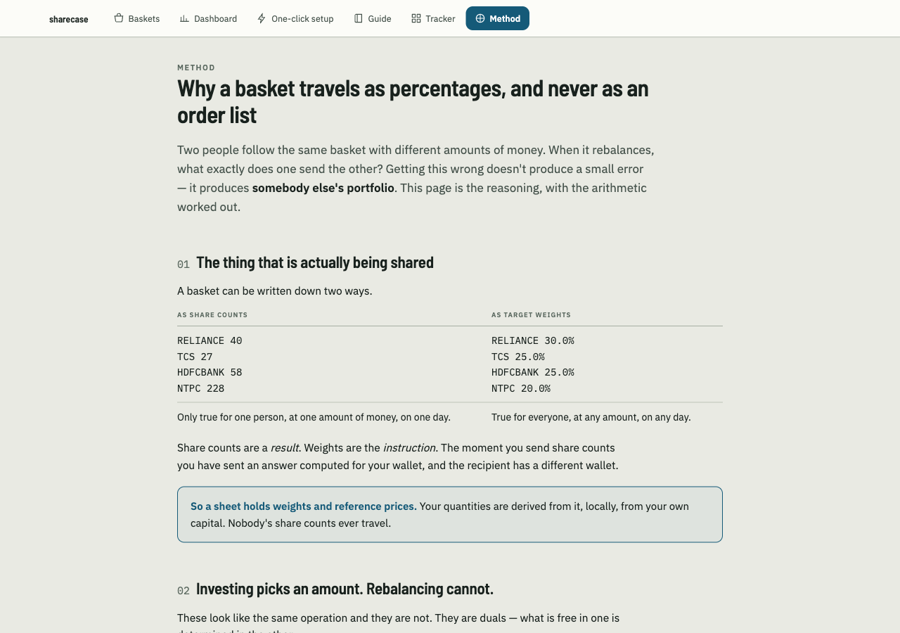
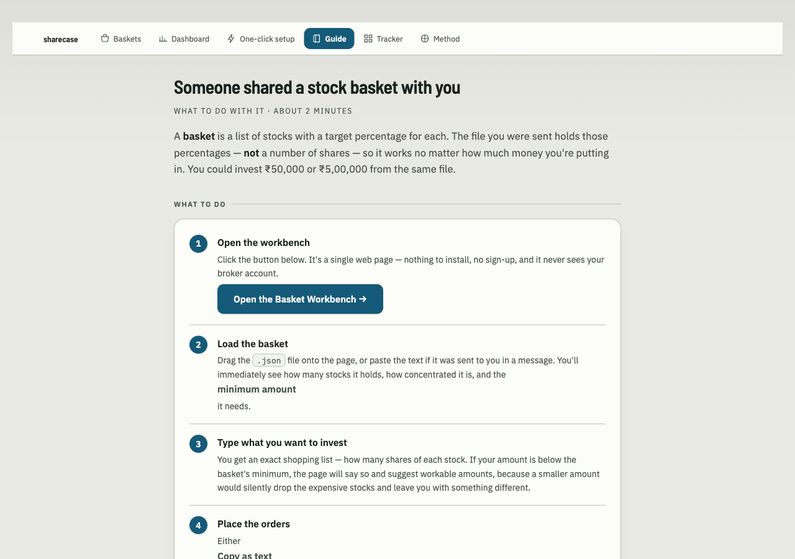

# sharecase guide

Everything the [README](../README.md) leaves out. Figures come from the fake files in
[`samples/`](../samples/) unless they are marked invented.

## Contents

- [Run and deploy](#run-and-deploy)
- [First buy: sizing a basket](#first-buy-sizing-a-basket)
- [Rebalance: there is no amount to choose](#rebalance-there-is-no-amount-to-choose)
- [The Workbench step by step](#the-workbench-step-by-step)
- [Sheets: the format that gets shared](#sheets-the-format-that-gets-shared)
- [Order emails: invest or rebalance](#order-emails-invest-or-rebalance)
- [The Kite handoff](#the-kite-handoff)
- [The Tracker](#the-tracker)
  - [What you give it](#what-you-give-it)
  - [What each figure means](#what-each-figure-means)
  - [How realised P&L is worked out](#how-realised-pl-is-worked-out)
  - [What it refuses to guess](#what-it-refuses-to-guess)
  - [Hide amounts and stored data](#hide-amounts-and-stored-data)
  - [Batch map reference](#batch-map-reference)
- [The dashboard](#the-dashboard)
- [The other pages](#the-other-pages)
- [Command-line tools](#command-line-tools)
  - [Export your data](#export-your-data)
  - [Dashboard from a tradebook](#dashboard-from-a-tradebook)
  - [Which holdings belong to which basket](#which-holdings-belong-to-which-basket)
  - [Share a basket](#share-a-basket)
  - [Size a sheet to your capital](#size-a-sheet-to-your-capital)
  - [Create and rebalance your own basket](#create-and-rebalance-your-own-basket)
- [Kite MCP and agents](#kite-mcp-and-agents)
- [The price endpoint](#the-price-endpoint)
- [What leaves your browser](#what-leaves-your-browser)
- [Your data and this repo](#your-data-and-this-repo)
- [Design](#design)
- [Self-checks](#self-checks)
- [Files](#files)
- [Limits](#limits)
- [Licence](#licence)

---

## Run and deploy

The README has the commands. The details:

- **Requirements.** Node, for `npx vercel dev`. Python 3.10 or later only for the command-line tools,
  and `openpyxl` only for `.xlsx`. There is no build step and no `node_modules`.
- **`npx vercel dev`** runs the pages and the price function exactly as in production. The first run
  asks you to log in to Vercel and link a project; after that it is one command. Open
  <http://localhost:3000/basket.html>.
- **`python3 -m http.server 8899`** (or opening the files from `file://`) serves the pages without
  `/api/price`. In the Workbench everything works except **Refresh prices from the market**, and the
  button says so rather than failing silently; sheets carry their own prices, so sizing, rebalancing
  and the Kite handoff are fine. The Tracker loses every live figure and tells you to run
  `npx vercel dev`: Current value reads ₹0 ("0 of N priced") and Unrealised reads —, because nothing
  could be priced, not because the holdings are worth nothing. Invested and realised still work.

**Why prices need a server at all.** A browser refuses to read a response from another origin
unless that origin allows it, and Yahoo does not. A serverless function is not a browser, so it can
read Yahoo and pass the answer on. Nothing in it is authenticated: no key, no token, nothing to leak.

**Deploying.** `npx vercel` from the repo root, or **vercel.com → Add New → Project → import the repo
→ Deploy**. `api/` is detected automatically. There are no environment variables. You get
`https://<your-project>.vercel.app`, serving the pages and `/api/price` from one origin, so the pages
call the relative path `/api/price` and there is nothing to configure.

**Kite redirect URL.** If you set up one-click ordering on your copy, register your deployment's
address as the redirect URL in your Kite app, not this project's. The One-click setup page prints the
address it is served from.

**Pages hosted somewhere else.** Both the Workbench and the Tracker call `/api/price` on their own
origin, so a copy of the pages on another host (GitHub Pages, say) will not reach a Vercel function
by itself. Adding that origin to `ALLOWED` in `api/price.js` is needed but not enough:

- The Workbench can be pointed at the function by setting the `localStorage` key `ft_px_proxy` to its
  full URL, from the browser console. There is no setting for it in the page.
- The Tracker has no override. It needs the pages and the function on one origin.

---

## First buy: sizing a basket

You were sent a basket sheet, a small `.json` file. Drop it on the
[Workbench](https://sharecase-mu.vercel.app/basket.html), answer **No — this is my first buy**, type
an amount and press **Calculate orders**. The screenshots use the built-in sample (**Try it with
sample data**, the same basket as `samples/sample_sheet.json`): RELIANCE, TCS, HDFCBANK and NTPC at
30 / 25 / 25 / 20%.


Reading it:

| | |
|---|---|
| **₹3,98,055 deployed** | what actually goes in after rounding to whole shares |
| **₹1,945 left** | the remainder, stated rather than hidden. Each stock is rounded to the *nearest* share, so the orders can cost more than you typed; the readout then says **₹X over** instead. On the sample, ₹2,00,000 costs ₹2,00,879 (₹879 over). Kite rejects orders you cannot fund |
| **Drift** | how far each holding lands from its target. Signed (`+0.1%`, `−0.2%`), so it survives greyscale |
| **`±0.2%` in the footer** | the worst drift in the basket |
| **Quick picks** | the lowest-drift amount inside each of five budget bands (1–1.3×, 1.3–1.8×, 1.8–2.6×, 2.6–4× and 4–6× the minimum), plus the sheet's own amount when it carries share counts. Each button says "spot on" or how many rupees would land in the wrong stock |

As you type, the page says how much money would sit in the wrong stock and which stock is furthest
off, or says plainly when nothing near your amount does better. Under the orders, the **Get closer
to the target weights** panel suggests nearby amounts that land closer (₹4,44,000 in the
screenshot); when there is none it shows nothing, or says drift is already about zero. A suggestion
can also overshoot: ₹4,44,000 costs ₹4,44,765.

**The minimum** is the smallest amount at which every stock gets at least one share and the orders
still fit inside the amount. The Workbench finds it by trying amounts against the same rounding the
order table uses, so if you invest the stated minimum, the orders really do fit. That guarantee is
for the minimum only; above it, see "over" above. For the sample basket it is **₹12,554**.

**Below the minimum it refuses**, rather than quietly dropping the stock it cannot afford. It names
the stock that sets the floor and offers 1×, 2× and 3× the minimum:


Then either **Copy as text / CSV**, or **Place in Kite**, which opens Kite in a new tab with the whole
basket pre-filled. See [The Kite handoff](#the-kite-handoff). Nothing is placed by this page.

---

## Rebalance: there is no amount to choose

**Investing is a choice: you pick the amount. A rebalance is not.** The capital is already set by
what you hold, so there is no multiplier to pick. Answer **Yes — I own some already** and drop your
holdings. sharecase values them at the sheet's prices (today's, if you pressed **Refresh prices**),
applies the new target weights to that value, and the orders are the difference:

```
value      = Σ (shares you hold × price)
target_qty = round(value × target_weight / price)
order      = target_qty − shares you hold        → BUY if positive, SELL if negative
```

Holdings come from a broker export (Kite or Console holdings `.xlsx`, or any `.csv` with symbol and
quantity columns; a price column is optional) or rows pasted from your broker. Shares bought in the
previous session and not yet settled (T1) count as held. Today's buys are not in holdings yet; Kite
lists them under positions.

### A worked example

The sample basket, with this invented holding pasted: RELIANCE 30, TCS 30, HDFCBANK 40, NTPC 150, at
the sheet's prices.


The header reads **₹3,21,260 → ₹3,21,260 at target → 4 orders**.

| Stock | You hold | Target | Action |
|---|---|---|---|
| RELIANCE | 30 | 30% | BUY 2 |
| TCS | 30 | 25% | SELL 8 |
| HDFCBANK | 40 | 25% | BUY 7 |
| NTPC | 150 | 20% | BUY 33 |

Footer: **buy ₹29,520 · sell ₹29,617 · net −₹97**. A rebalance is usually close to cash-neutral.

- **NOW vs TARGET**: each stock's share of your holding today, against what the basket now wants.
- **DRIFT**: the gap between them.
- **ACTION**: the exact whole-share order, BUY or SELL.
- **EXITED**: a stock the basket used to hold and has since dropped, which you still own. It is
  marked EXITED and sold in full. Without this it would sit in your portfolio forever, because a
  rebalance email never mentions stocks it no longer contains. It can only be detected when the
  sheet carries share counts (`shares`), as sheets built from an order email do. The sample sheet has
  no `shares`, so this example has no EXITED row.
- **Unrelated holdings**: a stock in neither the weights nor `shares` is left alone and listed, so a
  whole-account export never turns into "sell everything that isn't in this basket".

### The one real choice: are you also adding cash?

There is a box for it, and it changes the answer. The same holding with ₹2,00,000 added:

| Stock | No extra cash | +₹2,00,000 |
|---|---|---|
| RELIANCE | BUY 2 | BUY 23 |
| TCS | **SELL 8** | **BUY 5** |
| HDFCBANK | BUY 7 | BUY 36 |
| NTPC | BUY 33 | BUY 147 |
| Net | −₹97 | +₹2,00,045 |

Nothing is sold with the cash added. The TCS sell flips to a buy: you reach the same target weights
by topping up the underweight stocks instead of trimming the overweight one, so there is no realised
gain and no tax event. A negative amount works too, if you are taking money out.

Two more controls:

- **Part of the way.** Move 100, 75, 50 or 25% of the distance to target. A dropped stock is always
  sold in full.
- **Snap.** Offered when your holding is within about 2% of a whole multiple of the sheet's share
  counts (with the stocks agreeing on that multiple) and you are not adding cash or moving part of
  the way. It targets exactly that multiple, so positions that should not move do not get one-share
  rounding orders.

### When the holding is too small, or not this basket

The floor that blocks a first-time buy still exists, but the capital is given rather than chosen, so
the page names the problem instead of blocking. If a stock's target rounds to zero shares at your
value, it says so, because `SELL all` on that line is a rounding artefact and not a decision to exit.
It also warns when you hold none of the basket (and offers the first-buy path) and when your file has
under 60% of the basket's stocks.

It also carries a standing reminder that a stock held in two baskets shows false drift: the broker
reports one merged quantity, so another basket's shares count against this basket's target. This is
a reminder, not a detection; the page does not know which of your stocks are shared. Check the
Tracker's split chips before acting on a large drift.

---

## The Workbench step by step

Two tabs, framed by intent.

**I received a basket**

1. **Open the basket:** drop or pick a `.json` / `.txt`, paste the text, or **Try it with sample data**.
2. **What's in it:** the minimum investment (and the stock that sets it), concentration, and the
   largest and top-3 weights. Stocks with no price get a box to type one. **Refresh prices from the
   market** is optional: it lists the symbols and asks before sending them, keeps prices for 15
   minutes, and leaves the sheet's own prices alone if it fails.
3. **Do you already hold any of this basket?** No → an amount. Yes → your holdings. It starts on
   rebalance only if the basket is already in your follow list, and you can switch either way.
4. **The amount** (quick picks, live advice), or **your holdings** (an `.xlsx` / `.csv` export, or
   pasted rows).
5. **The orders:** **Copy as text** (`BUY 12 SYM @ ~price (CNC)`), **Copy as CSV** (`symbol,
   exchange, transaction_type, quantity, product, order_type`), or **Place in Kite**.

**I want to share one**

1. **Paste an order-confirmation email.** Rows like `SYM 8 of 8 BUY 1,512.30` (invented) are read,
   `0 of N` rows are left out with a note. A name is needed because it becomes the Kite tag: the Name
   or Theme box, the loaded sheet's label (for a rebalance), or the email's own basket name. The page
   asks only when all of those are empty.
2. **Or type the stocks:** one per line with an optional price and weight, separated by commas, tabs
   or spaces, so an Excel paste is fine. Symbols alone give equal weight; custom weights are
   normalised. Optionally set theme and risk.
3. **Or drop a holdings file** to turn what you own into a basket, with share counts kept. It is
   weighted by LTP or close price when the file has one, otherwise by average cost. If a sheet is loaded, the result is limited to that basket's stocks.
4. **Use it now**, **Download .json** or **Copy JSON**. For sheets built from an email or holdings
   file, the panel also says how exact the weights are (one share of the priciest stock, in
   percentage points) and warns above 2pp. Those sheets carry your real share counts in `shares`, so
   the file you share lets anyone work out your position. The panel does not warn about this; a
   typed list carries weights only.

**Baskets you follow** are remembered in this browser with a short history each, and can be exported
and imported as a backup file. The last sheet and amount you used come back when you reopen the page.

Nothing is uploaded. The page makes three kinds of request: the pinned, SRI-hashed SheetJS used to
read `.xlsx`; `/api/price` when you press Refresh prices; and the form POST to Kite when you press
Place in Kite. CSV and JSON are parsed natively.

The page has an in-page self-test, `selfTest()`, for the sizing maths. Nothing calls it; run it from
the browser console on `basket.html`. It throws on the first failure.

---

## Sheets: the format that gets shared

A sheet is the whole format, and it is broker-agnostic. An invented example:

```json
{"label": "My Basket", "asof": "2026-08-12",
 "weights": {"INFY": 60.0, "TCS": 40.0},
 "prices":  {"INFY": 1420.5, "TCS": 3850.0}}
```

| Field | |
|---|---|
| `weights` | Required. Relative proportions, normalised to 100% |
| `label`, `asof` | The name (the Workbench uses "Untitled basket" if it is missing) and the date of the prices |
| `prices` | Optional in the Workbench, which lets you type missing ones or refresh them; required by the CLI |
| `theme`, `risk` | Optional labels. `theme` is free text; `risk` is `low` / `moderate` / `high`, colour-coded in the page |
| `shares` | Optional share counts, written by sheets built from an order email or a holdings file. They let a rebalance detect EXITED stocks, apply a rebalance email, offer the sheet's own amount as a quick pick, and snap to an exact multiple |

Sizing uses **weights, not share counts**, deliberately. Share counts are valid at one capital size
and one moment's prices; weights survive both. But a sheet built from an order email or a holdings
file also carries the sender's exact `shares`, and **Download .json** / **Copy JSON** include them.
Shares times prices is the sender's position. If that matters, share a typed list instead.

**Weights don't have to sum to 100.** They are treated as relative proportions and normalised, so a
sheet whose weights sum to 56% (invented) still deploys your full amount. The CLI and the page both do
this, and the page warns when the sum was off by more than 1.

**Effective holdings** is `1 / Σ(weight²)`, the inverse Herfindahl index. A 15-stock equal-weight
basket has about 15; if one position dominates, the number collapses toward 1 however many stocks are
listed.

Basket constituents from a **paid** subscription are that provider's IP. Check their terms before
sharing sheets.

---

## Order emails: invest or rebalance

An **Invest** email lists a whole basket. A **Rebalance** email lists only the changes, so reading it
as a basket would give you a fragment. The Workbench tells them apart on three signals:

| Signal | Example |
|---|---|
| The subject line | `Rebalance Order Successful` |
| The **Order Type** value | `Order Type / Rebalance / ₹12,345.60 / ₹11,890.25` (invented) |
| **Any SELL row at all** | an initial Invest only ever buys, so one sell proves it is a delta |

The last one survives pasting just the orders table with no headers. Repair and Exit emails are
recognised too, and a "rebalance pending" notice is rejected rather than read as an order.

A rebalance is applied as arithmetic on the basket you already had, `new = old + bought − sold`,
which is why sheets built from an order email carry share counts. Fill prices from the rebalance
update the stocks it touched; untouched stocks keep their older prices, and the page says so.

**If someone forwards you their rebalance email**, its quantities were computed for their position,
not yours. The Workbench refuses it when it asks to sell more than your sheet holds, and flags it
when it sells a meaningful holding to exactly zero or moves more than about 35% of the basket's value,
both signs of an email belonging to a bigger position. Ask for their updated **sheet** instead.

---

## The Kite handoff

With a free Zerodha app (about five minutes to set up, no paid API), the page POSTs the order list to
`kite.zerodha.com/connect/basket` and Kite opens with everything pre-filled. This is Kite's documented
[offsite orders](https://kite.trade/docs/connect/v3/basket/) flow: a `POST` with two form fields,
`api_key` and `data`, submitted from the browser.

- **App type.** **Publisher** is recommended because it has no API access at all, the least privilege
  that does the job. It is not required: the spec names no app type, and a **Personal** key works at
  the same endpoint. Copy the **API key** field, not the **API secret** beside it; the secret gets
  `Invalid api_key` from Kite.
- **It appears once a key is saved** on the [One-click setup](https://sharecase-mu.vercel.app/onboarding.html)
  page. Until then the Workbench shows a link to it where the button would be.
- **Both directions.** Buys for a first-time purchase; buys and sells for a rebalance.
- **Order type.** The first-buy panel offers limit or market, and a buffer field (2% to start) that
  sets how far from the sheet price the limit goes: above it for a buy, below it for a sell, so a
  limit sell can actually fill. A rebalance has no controls of its own: it reuses whatever that
  panel is set to in the same page session. Leave it alone and every rebalance order is LIMIT with a
  2% buffer; pick market or 5% for a buy and then rebalance, and the rebalance goes out as market or
  with 5%. A buffer of 0 is treated as 2%. Limit prices are rounded to one decimal.
- **Limit orders work; off-tick prices do not.** What Kite rejects, with a bare "Failed to place
  order", is a limit price in stray paise that is not on the stock's tick, so use whole rupees or a
  valid exchange tick. Above about ₹5,000 the tick is ₹0.50 or more, so even the Workbench's
  one-decimal limit price can be rejected for those stocks.
- **Everything is `NSE · CNC`** (delivery).
- **show what gets sent** displays the exact `api_key` and order JSON before you send anything.
- **Your API key goes to Kite and nowhere else.** It is kept in this browser's `localStorage` and sent
  only as the `api_key` field. It identifies the app, not you: Kite still asks for your login and 2FA.
- **Nothing is placed until you confirm in Kite.** The page cannot place an order.
- **Symbol series.** If you have loaded a holdings file and hold a stock only under a suffixed NSE
  symbol (`X-BE` where the sheet says `X`), the order uses the one you hold, and never guesses when
  two variants could match. Trade-to-Trade (`-BE` / `-BZ`) orders get a warning, because Kite needs a
  per-stock consent a basket cannot carry.

### Telling baskets apart in Kite

Every order carries a **tag** made from the basket label (letters and digits only), so Kite's order
book shows which basket each order came from.

- **Kite caps the tag at 8 characters.** The docs say 20; the API returns
  `` `tag` should be max 8 characters ``. Labels are truncated, so two baskets whose names share the
  first 8 letters and digits collide. Give them distinct short names.
- **Holdings never carry the tag, only orders do**, and the API returns only today's orders. A
  basket's identity has to be recorded on the day it executes; after that the link is gone from the
  broker's side. The Tracker's batch map and `basket.py record` exist for this.

---

## The Tracker

**[Open the Tracker](https://sharecase-mu.vercel.app/baskets.html)**

Kite shows one merged holding per stock and one realised P&L for the whole account, so if you run
several baskets it cannot tell you how each is doing. The Tracker can, because you tell it what each
basket holds (a **batch map**) and it reads your tradebooks for what you sold.

To try it with fake data, drop [`samples/sample_map.json`](../samples/sample_map.json) on the page:
three invented baskets, one stock shared by two of them, and a hand-kept sales ledger. There is no
sample tradebook for the Tracker, so the realised figures in that demo come from the ledger.


### What you give it

| File | | What it adds |
|---|---|---|
| A **batch map** `.json` | one | The baskets: which stocks each holds, how many, at what average cost. Same shape as the `_smallcase_map.json` that `basket.py record` writes. See the [reference](#batch-map-reference) |
| Zerodha **tradebook** `.xlsx` / `.xls` | optional, any number | Realised P&L, costed FIFO. Console → Reports → Tradebook |
| or a **Kite orders** JSON array, instead of a map | alternative | `COMPLETE` orders grouped by tag, with sells netted out. Orders with no tag are grouped as "Untagged orders" |

- **One selection, two kinds of file.** Anything that is not `.xlsx` / `.xls` is treated as a map, and
  only the first such file is read, so do not include CSVs in the selection.
- **Drop tradebooks on their own to see the date range.** After loading tradebooks the page says how
  many trades were new, the unique total, and the first and last trade date. When a map is in the same
  selection, loading the map replaces that message. A missing year shows up later as sales it cannot
  cost, so this message is where you would catch it.
- **Overlapping exports are fine.** Each trade is keyed on its date, exchange and Trade ID, so a trade
  that appears in two files counts once.
- **It has to be Console's spreadsheet.** The page finds the header row itself and names any missing
  column. It needs Symbol, Trade Date, Trade Type, Quantity, Price, Trade ID and Exchange, and uses
  Order Execution Time and ISIN when present. CSV tradebooks, including
  `samples/sample_tradebook.csv`, are not read here; the dashboard reads them.
- **Raw orders use the first tag.** For an orders array the tag is `tag`, or the first entry of
  `tags`. If a platform puts its basket marker in a later tag (see
  [Which holdings belong to which basket](#which-holdings-belong-to-which-basket)), build a batch map
  instead.

### What each figure means

Each basket is one line: its name, its tag, the number of stocks, Invested → Current value,
unrealised in rupees and %, and, once something has been sold, a quieter `tot` total return. Open it
for the detail.

| Figure | What it is | Divided by |
|---|---|---|
| **Current value** | shares × live price, for the stocks that got a price ("N of M priced") | — |
| **Invested** | shares × average buy price for what you still hold. Needs no live price | — |
| **Unrealised** | value − cost, over stocks that are both priced and costed | the cost of those same stocks |
| **Realised** | gross profit booked by selling, from your tradebooks (FIFO), the map's `sells` ledger, or both | the cost of the shares sold |
| **Current return** | unrealised, as a % | the cost of what you still hold |
| **Total return** | unrealised + realised, shown with the rupees "on X ever deployed" | cost still held + cost of the shares sold |

Why the denominators differ, on invented numbers. A basket put ₹1,00,000 to work. It sold a quarter
(cost ₹25,000) for ₹30,000, and the remaining ₹75,000 of cost is now worth ₹78,000.

- Unrealised: +₹3,000 on ₹75,000 = **+4.0%**
- Realised: +₹5,000 on ₹25,000 = **+20.0%**
- Total: +₹8,000 on ₹1,00,000 = **+8.0%**

Dividing the ₹8,000 by the ₹75,000 still held would give +10.7%, which mixes money already returned
with money still invested. Unrealised alone would make the basket look worse the day it trimmed a
winner, because trimming moves that profit from unrealised into realised. The Current return and
Total return tiles appear only once a costed sale exists (a tradebook sale, or a ledger entry with
`cost`); until then use the Unrealised %.

Total return is not time-weighted: capital returned in April counts the same as capital still
deployed today. The page does not compute XIRR (a tradebook does not say which basket each buy
belonged to). The only XIRR shown is the platform's own, if you put its figures in `sc`.

Inside each basket:

- **Holdings table:** shares, average buy, price now, invested, value, P&L, return % and weight inside
  the basket, sorted by value. On a phone it scrolls sideways with the symbol pinned.
- **The tag chip** is solid when Kite recorded the tag on the order, and dashed and marked
  `· internal` when it is a label you assigned (a batch with no `tag`, or `tag_source: "internal"`),
  so you never mistake your own label for broker data.
- **The name** is yours to edit and is saved per tag.
- **A stock in two baskets** gets a chip naming both, such as `CORE + POWER` in the sample, and the
  All baskets panel lists the split, for example `ALPHA 8 + BETA 3 = 11` (invented). Kite reports
  those 11 shares as one holding, so this is the only place you can see that selling 8 would empty
  ALPHA's position and leave BETA's alone. Weights are computed inside each basket, so the stock
  counts in both.
- **Platform figures:** if you paste the platform's own numbers into `sc`, they are shown beside ours
  with the reasons they differ (realised, dividends, cost basis), a value cross-check and the next
  rebalance date.

**All baskets**, at the top, adds up value, invested, realised (sales attributed to a basket only) and
unrealised. With tradebooks loaded, **From your tradebooks** shows the account's whole FIFO realised
against the part that belongs to baskets, and says where the rest went: *Closed positions*, *Before
the basket*, *Unattributable*, *Not date-gated* and *Not costable*, each with its reason. A **Total
return so far** line then adds unrealised and realised for the baskets, and says that the non-basket
remainder is left out and why.

### How realised P&L is worked out

Each rule is here because the simpler version gave a plausible, wrong number. All examples use
invented stocks and prices.

- **FIFO.** Each sale is matched against your oldest open shares first, as Console and the tax return
  do. Buy 10 at ₹100, then 10 at ₹120, and sell 10 at ₹130: realised is +₹300 (against the ₹100 lot),
  where an average cost would say +₹200.
- **In execution-time order.** Trades are sorted by date, then Order Execution Time, then buys before
  sells, then exchange, then trade ID. If you bought on NSE in the morning and on BSE in the
  afternoon, the morning lot is sold first.
- **Renames merged by ISIN.** If OLDCO became NEWCO, the buys are under one symbol and the sale under
  another. Symbols that share an ISIN are treated as one holding under the later name, so old buys
  cost new sells.
- **Corporate actions.** A split or bonus changes your share count with no trade row. Hold 10 FOO at
  ₹100, receive a 1:1 bonus, sell all 20: without the bonus, half the sale has no shares to match.
  With it recorded in `corporate_actions`, the 10 bonus shares are added at nil cost behind your
  existing lot, and the sale is costed correctly.
- **Dated membership.** A sale is credited to whichever basket held that stock on the day of the
  sale. Dates come from `membership` windows; `ever_held` and `holdings` alone give a symbol an
  open-ended window. So if ALPHA's window for FOO ends in March and BETA's starts in May, a March sale
  stays with ALPHA and a later trade cannot rewrite it. With only `ever_held`, a symbol that two
  baskets have held overlaps on every date, and each of its sales is *Unattributable* unless a
  matching `sells` ledger entry settles it. A sale of a stock no basket held that day goes to *Closed
  positions*, or to *Before the basket* if a basket picked the stock up later.
- **Before the basket.** If you traded FOO yourself in January and the basket that holds it now began
  in March (its `executed` date), the January result is shown as *Before the basket*, not credited to
  a basket that did not exist yet.
- **Shared sales and the ledger.** If two baskets both held FOO on the day it was sold, the tradebook
  cannot say which one sold, so the sale is *Unattributable*, unless you recorded it in each basket's
  `sells` ledger. Then the realised P&L is split between them by quantity, still at FIFO cost. The
  ledger is trusted only when its quantity for that stock and day equals what the tradebook sold, and
  only for baskets that held the stock that day.
- **Sales newer than your last export.** A Console tradebook does not include today's trades. Once at
  least one tradebook is loaded, fills saved in the map under `rebalance_*`, `topup_*` or `exit_*`
  records dated after the last exported trade are FIFO-costed as if they were trades. Dated `sells`
  entries are added on top only if they are after the last date covered by the exports **or** by
  those map fills, so a ledger sale dated on or before the newest map fill is not added. A newer
  export replaces them, so nothing is counted twice. An undated ledger entry is never assumed to be
  recent. If tradebooks are loaded but none of their sales is credited to a basket, that basket's
  realised falls back to its whole ledger, not just the newer rows.

### What it refuses to guess

- **A sale with no purchase in any export** is left out of realised and listed under *Not costable*,
  with its proceeds. Counting it at zero cost would book the whole sale as profit.
- **A holding with no cost basis** (no `avg`, or a sale in the file with no earlier buy) is named and
  left out of Invested and Unrealised, never given an invented cost.
- **A basket with no start date** (`executed` missing, or prose like "various") cannot be split into
  before and after. It is listed under *Not date-gated*, and its total return carries a "see caveat"
  note.
- **Mixed cost methods.** If one basket's realised combines FIFO-costed tradebook sales with newer
  ledger sales costed at the map's average, the rupees are shown but the Realised % and Total return %
  are withheld (`tot —`, "ratio withheld"), with the reason. Re-exporting the tradebook brings them
  back.
- **No live price.** The stock is left out of value and unrealised, with a warning that Value minus
  Invested will not equal Unrealised while it shows.
- **Down more than 50% from cost.** The basket gets a `?` flag and a prompt to check for a split or
  bonus that has not been credited. The page sees only your cost, not yesterday's close, so it cannot
  tell a corporate action from a bad holding, and does not try.
- **A split or bonus whose shares have not reached your demat** (`pending_ca.ratio` on the holding):
  the headline figures stay as your broker reports them, and the corrected value and return are shown
  beside them, per basket and for the portfolio. A ratio that is not a number above 1 and at most 50
  is rejected with a warning.

Every realised figure is **gross**: brokerage, STT, stamp duty and GST are in no Kite export, and
neither are dividends, so your net is lower. Unrealised uses Kite's average cost while realised uses
FIFO, as Kite itself does, so the combined total can differ a little from a single-method figure.

### Hide amounts and stored data

- **Hide amounts** masks every rupee figure and share count as `•••` and keeps the percentages, for
  screenshots. Average buy prices and live prices stay visible: the average can be worked back out
  from the price and the return %, so hiding it would hide nothing. The setting is remembered.
- **Kept in this browser.** The map you imported and your tradebook trades are stored in
  `localStorage`, so a later visit shows your baskets without re-uploading. A strip says what is stored
  and when it was imported.
- **Forget this data** deletes the map, the trades, your basket names and which baskets were open.
- **Only stock symbols leave the device**, sent to this app's `/api/price`, 40 per request. This
  happens on every load, including a visit that restores saved data, with no prompt. Never quantities
  or cost.
- **Safety nets.** If storage ever holds duplicate trades, a warning says realised is overstated and
  tells you to Forget and re-pick. A file that leaves no open positions never overwrites a saved map.

### Batch map reference

An invented example:

```json
{
 "batches": {
  "ALPHA_1": {
   "tag": "ALPHA", "label": "Alpha basket", "executed": "2026-03-02",
   "holdings": {"FOO": {"q": 20, "avg": 50.0}, "BAR": {"q": 4, "avg": 250.0}},
   "ever_held": ["FOO", "BAR", "BAZ"],
   "membership": {"BAZ": {"from": "2026-03-02", "to": "2026-05-15"}},
   "sells": [{"s": "BAZ", "q": 5, "date": "2026-05-15", "order_id": "X1", "price": 130.0,
              "proceeds": 650.0, "cost": 500.0, "realised_gross": 150.0}]
  }
 },
 "corporate_actions": [{"s": "FOO", "type": "bonus", "ratio": 1,
                        "record": "2026-04-10", "effective": "2026-04-11"}]
}
```

| Field | Where | What it does |
|---|---|---|
| `batches` | top level, **required** | `{KEY: batch}`. KEY becomes the basket's tag, marked internal, when the batch has no `tag` |
| `tag` | batch | The Kite order tag, which is the grouping key. Batches that share a tag merge into one basket, which starts at the earliest `executed` among them. The last such batch's `sells` and `sc` are shown and used for the no-tradebook realised figure; every batch's `sells` still count for splitting shared sales; the first batch's `label` is used |
| `tag_source` | batch | `"internal"` marks the tag as your own label rather than Kite's |
| `label` | batch | The default display name, used until you type your own |
| `holdings` | batch, **required** for anything to show | `{SYM: {q, avg}}`: what the basket holds now. No `avg` means no cost basis. `pending_ca: {ratio}` records a split or bonus not yet credited |
| `executed` | batch | When the basket began. Its leading `YYYY-MM-DD` dates the basket, so earlier sales count as *Before the basket*. Missing or prose makes the basket undateable |
| `ever_held` | batch | Every symbol the basket ever held, including exited ones, so realised on a stock since dropped is still credited to it. Gives the symbol an open-ended window, so it cannot separate two baskets that held the same symbol |
| `membership` | batch | `{SYM: {from, to}}` in `YYYY-MM-DD`, `null` for open-ended, both ends inclusive. Overrides the open-ended window from `ever_held` and `holdings`, and is what lets a shared symbol's sales be dated to one basket. Dates are compared as text, so keep the format |
| `sells` | batch | A hand-kept sales ledger: `[{s, q, date, order_id, price, proceeds, cost, realised_gross}]`. Supplies realised when no tradebook is loaded (or none of its sales is credited to this basket), tops up sales newer than the tradebook, splits a sale two baskets share, and is listed per basket. Splitting needs `date` and `q`; `order_id` is used only to order the entries when several baskets sold that day. Without `cost`, the Realised % and Total return cannot be shown |
| `rebalance_*` `topup_*` `exit_*` | batch | `{date, fills: {SYM: {qty, avg_fill, side, order_id}}}`: one day's fills, FIFO-costed until an export covering that date is loaded. `side` is `BUY` or `SELL`, and defaults to `BUY` |
| `sc` | batch | The platform's own figures for the comparison box: `total_returns_pct`, `total_returns`, `realized_returns`, `dividends`, `current_investment`, `current_value`, `xirr_pct`, `next_rebalance` |
| `symbol_aliases` | top level | `{mapSymbol: tradebookSymbol}` for a symbol named differently in the map than in the tradebook (a suffix the export drops, say), so its sales land in the right basket. Explicit, never guessed |
| `corporate_actions` | top level | Applied in date order, as below |

| `type` | Fields | Effect on FIFO |
|---|---|---|
| `split` | `s`, `effective`, `ratio` | From `effective`, every lot: shares × ratio, price ÷ ratio |
| `bonus` | `s`, `effective`, `ratio`, `record` | ratio × the shares held at the close of `record`, added on `effective` at nil cost, behind your existing lots |
| `credit` | `s`, `effective`, `qty`, `price` | `qty` shares at `price` on `effective` (a rights entitlement, an IPO allotment) |
| `demerger` | `s`, `record`, `ratio`, `child`, `cost_fraction` | At the close of `record`, each lot of `s` creates ratio × its shares of `child`, carrying `cost_fraction` of the lot's cost; `s` keeps the rest |

`record` defaults to `effective`. Other types are not applied.

---

## The dashboard

**[Open the dashboard](https://sharecase-mu.vercel.app/dashboard.html)**

Drop a Zerodha Console tradebook (`.xlsx`, `.xls` or `.csv`), a holdings JSON, or both one after
the other (each drop reads one file, and the second merges with the first), for
FIFO-matched realised P&L, a realised curve, per-basket concentration and a "what if I never sold"
counterfactual. It is parsed in the browser. Served next to a `live.json` (see
[Dashboard from a tradebook](#dashboard-from-a-tradebook)), the page loads it by itself and re-reads
it every 30 seconds.


**Holdings JSON.** The browser accepts rows with just `s` (symbol) and `q` (quantity); the other
fields in the [format](#holdingsjson-format) are optional there. `build_dashboard.py` is stricter and
needs `s`, `q`, `avg`, `ltp`, `pnl` and `grp` on every row.

| Tab | Answers |
|---|---|
| **Overview** | Cumulative realised curve, allocation tiles sized by value, basket concentration. "Where is my money, and how concentrated am I?" |
| **Live Holdings** | Filter and sort by basket, per-position P&L with today's move, distance-to-stop bars. "What needs attention right now?" |
| **Realised** | Gross profit − gross loss = net, profit factor, per-stock league table, full round-trip ledger. "Is my edge real?" |
| **Never Sold** | Replays every buy and ignores every sell, valued at today's prices, against what you actually made on the same stocks. "Did selling help?" |
| **The Paradox** | Strike rate, average winner, average loser and reward:risk, and what the book becomes without its single best trade. "Is the edge being right, or letting winners run?" |

How to read the numbers:

- **Profit factor** = gross profit ÷ gross loss. Above 1.0 makes money. It is a better signal than
  win rate: you can win one trade in three (invented) and still be profitable if the winners are big
  enough.
- **Net P&L is the number**, not gross. On invented figures, ₹2,00,000 of gross profit with
  ₹1,30,000 of losses is ₹70,000. The dashboard shows the subtraction because the gross figure
  flatters.
- **Max drawdown**, the worst peak-to-trough on the realised curve, is computed (`max_dd` in
  `live.json`) but not displayed yet.
- **Concentration bar** length is exposure share. If one basket is over about 40%, that position
  decides your year.
- **Never Sold** is a hindsight check, not a strategy. It can only show trades that recovered; it
  cannot price the losses your stops prevented. Use it to audit your exit rule. It prices only stocks
  that still have a price in the holdings you loaded (the holdings file's `ltp`, not a live price),
  so stocks you have fully exited drop out of both sides, and a warning names them.

**The dashboard's FIFO is simpler than the Tracker's.** It matches oldest lot first, but it does not
merge renames by ISIN and does not apply splits, bonuses or other corporate actions. Its round trips
match Console only for a full-history tradebook with none of those; the Tracker's FIFO handles both.

**Basket groups come from your holdings.** Each holding's `grp` becomes its group. The Live Holdings
filter buttons, Overview's *Open Positions by Basket* headings, the concentration bar, the Mix donut
and their colours are built from whatever `grp` values the loaded holdings carry, ordered by value,
with Other (a holding with no `grp`) last.

---

## The other pages

**[Method](https://sharecase-mu.vercel.app/method.html)** explains what is actually being shared, why
investing picks an amount and a rebalance cannot, and what happens if you send an order list instead
of weights, with the arithmetic worked out on the sample basket.



The question everyone asks: *"I bought 2× the minimum, my friend bought 1×. When it rebalances, my
orders are sized to my holding. How does his app know to use 1×?"* It never needs to. He is not sent a
multiple of anything; he is sent **weights**, and applies them to his own value. The multiplier is a
property of a wallet, not of the basket. Send him the order list instead and, on the Method page's
sample basket, his TCS position goes to zero: **1.39pp** off target the right way, **20.26pp** the
wrong way.

**[Guide](https://sharecase-mu.vercel.app/friends.html)** is a plain-English page, about two minutes,
for someone who has been sent a basket.



**[Landing page](https://sharecase-mu.vercel.app/)** shows the idea in one screen: one shared file
sized to two amounts of money, on illustrative prices. `designs/verify_landing.py` checks its table
and its ₹9,290 minimum, worked out the way the Workbench does it: the smallest amount at which every
stock gets at least one share and the orders cost no more than the amount.


---

## Command-line tools

Everything above works in a browser. If you would rather script it, `basket.py` and
`build_dashboard.py` cover similar ground. `basket.py` never places an order and does not read Kite
tags: it reminds you of a tag you choose (`orders --tag`) and records the basket under it
(`record`); you pass the tag yourself when placing in Kite. It also exports a basket you have
captured. Finding the tag a platform used is done with the Kite MCP's `get_orders`, below.

```bash
pip install openpyxl                      # only needed for .xlsx

python3 basket.py demo                    # self-check; prints "demo OK"
python3 basket.py orders samples/sample_sheet.json 400000       # size a sheet to your capital
python3 basket.py rebalance samples/sample_sheet.json samples/sample_holdings.json

python3 build_dashboard.py samples/sample_tradebook.csv \
        --holdings samples/sample_holdings.json
python3 -m http.server 8787               # then open dashboard.html
```

`basket.py demo` also prints `wrote eqtest_sheet.json`. It writes that file inside a temporary
directory, not your current one.

The main differences between the CLI and the browser:

- **A different minimum.** `basket.py` uses a floor-based formula that reproduces smallcase's
  published minimum on the baskets tested in the Workbench's `selfTest()` (smallcase publishes no
  formula); the Workbench searches for the smallest amount its own rounding can fund. For `samples/sample_sheet.json` that is ₹12,905 in the CLI against ₹12,554 in the browser,
  and the CLI refuses anything below its own figure. Trust the Workbench's number when placing orders:
  it is tested against the same rounding that produces them.
- **Rebalance covers the sheet's own stocks only**, so there is no EXITED or unrelated handling, no
  cash box and no partial move.
- **Rebalance prices.** The CLI prices holdings at the holdings file's `ltp`; the Workbench uses the
  sheet's prices, or refreshed ones if you pressed **Refresh prices**.
- **No order emails.** Only the Workbench parses them.
- **Stricter sheets.** The CLI needs a `label`, `weights` and a price for every stock; the Workbench
  needs only `weights` and lets you type missing prices.

### Export your data

Two halves, and only one of them has an API.

| Data | Source | How |
|---|---|---|
| **Tradebook** (realised P&L) | Zerodha **Console** | Manual: Console → Reports → Tradebook → date range → download XLSX. **No API exists for this**; Console is a separate back-office system. The Tracker reads only the XLSX |
| **Tax P&L** (all-time, with cost basis) | Console → Reports → P&L | Manual download. Use it for `--pre` (realised booked before your tradebook's window) |
| **Holdings** | Kite MCP | `get_holdings`, mapped to `holdings.json` (format below) |
| **Order tags** | Kite MCP | `get_orders`, **same day only** |
| **Prices** | Kite MCP | `get_ltp` for a list, `get_quotes` for depth and circuit limits |
| **History** | Kite MCP | `get_historical_data` with an `instrument_token` |

Before you trust a number:

- **Unsettled buys.** Shares bought in the previous session and not yet settled appear as
  `t1_quantity`, not `quantity`, and count as held. Today's buys are not in holdings at all; they
  are in `get_positions`.
- **A fired GTT** shows as `quantity: 0` with `used_quantity: N` while the sale settles.
- **Holdings merge.** Buy the same stock via two baskets and you get one blended average price.
  Nothing recovers the split afterwards except your own capture.
- **Realised P&L is only as fresh as your tradebook.** Holdings are live; round trips are frozen at
  your last download.

### Dashboard from a tradebook

```
tradebook.xlsx ─┐
                ├─▶ build_dashboard.py ─▶ live.json ─▶ dashboard.html
holdings.json ──┘      FIFO + analytics
```

```bash
python3 build_dashboard.py <tradebook.xlsx|.csv> [options]

  --holdings holdings.json   adds unrealised P&L, basket grouping, stop-loss rail
  --pre <amount>             realised P&L booked before this tradebook's window
  --out live.json            output file (default: live.json)
  --updated "TEXT"           timestamp shown in the header
```

Column names are auto-detected across brokers (`Trade Type` and `trade_type` both work). `--pre` is
the only way to give the dashboard a realised base from before the tradebook's window.

#### holdings.json format

The first row of `samples/sample_holdings.json`:

```json
[{"s":"RELIANCE","q":25,"avg":2820.0,"ltp":2965.5,"pnl":3638,
  "grp":"Core","day":0.82,"sl":2650,"dpnl":604}]
```

| Field | Meaning |
|---|---|
| `s` `q` | symbol, quantity. The only fields the browser dashboard requires |
| `avg` `ltp` `pnl` | average buy, last price, unrealised P&L. Required by `build_dashboard.py` |
| `grp` | basket label; each distinct value becomes a group on the dashboard (filter buttons, *Open Positions by Basket*, the concentration bar and allocation tiles). Required by `build_dashboard.py` |
| `day` `dpnl` | today's % change, today's P&L in ₹ |
| `sl` | stop-loss trigger, or `null`; drives the distance-to-stop bars |

This format feeds the CLI and the dashboard. The Workbench's rebalance reads a broker `.xlsx` /
`.csv` export or pasted rows instead.

### Which holdings belong to which basket

**The problem.** Kite's holdings API returns a flat list. There is no basket field, and holdings from
different baskets plus direct buys of the same stock are merged into one average price. Zerodha have
confirmed holding tags are Console-only, not on Kite Connect.

**The way round it.** Basket platforms place their orders through Kite with a **shared order tag**,
and the orders API does return tags. So the link exists, in the order book. Invented example:

```jsonc
// GET /orders — every order from one basket carries the same second tag
{"tradingsymbol":"INFY", "tags":["aB3xY9zQ", "BATCH_01"]}
{"tradingsymbol":"TCS",  "tags":["kL7mN2pR", "BATCH_01"]}
```

**Kite Connect returns only the current day's orders.** Capture the tag on the day the basket
executes, or the link is gone for good.

Save what you find as `_smallcase_map.json` (gitignored). This is the batch map the
[Tracker](#the-tracker) reads. Invented example:

```json
{"batches": {"BATCH_01": {
  "tag": "BATCH_01", "label": "My Basket", "grp": "Basket", "executed": "2026-01-15",
  "holdings": {"INFY": {"q": 50, "avg": 1420.5},
               "TCS":  {"q": 20, "avg": 3850.0}}}}}
```

Include `"tag"` when Kite really recorded it; without it the Tracker marks the basket's tag as your
own label (`· internal`). Because the marker here is the second tag, give the Tracker this map rather
than the raw orders, since a raw orders array is grouped by the first tag. Then set each holding's
`grp` from the map when you build `holdings.json`; the dashboard makes each `grp` a group.

#### If you place the orders yourself

Then no platform stamps the tag, so stamp it yourself. Kite's `place_order` accepts a `tag` of up to
8 characters; pass the same one on every leg:

```bash
python3 basket.py orders their_sheet.json 200000 --tag FRIEND01
#   ... place each order with tag="FRIEND01" ...
python3 basket.py record FRIEND01 "Friend Basket" fills.json
```

`fills.json` is `{"SYM": {"q": qty, "avg": fill_price}, ...}` from your actual executions (gitignored).
`record` writes the batch into `_smallcase_map.json` in the current directory, keyed by the tag you
chose, with `grp` set to the label's first word. It does not write a `tag` field, so add
`"tag": "FRIEND01"` if you want the Tracker to show it as a Kite tag. `basket.py` does not check the
8-character limit; Kite does, by rejecting the order.

You already know the tag, so nothing expires. The same-day `get_orders` window only matters for
baskets a platform placed on your behalf.

### Share a basket

```bash
python3 basket.py export BATCH_01          # → BATCH_01_sheet.json
python3 basket.py md BATCH_01_sheet.json   # → BATCH_01_sheet.md (human / LLM readable)
```

`export` reads `_smallcase_map.json` from the current directory and writes a sheet weighted by cost,
priced at each holding's average. The format is in
[Sheets: the format that gets shared](#sheets-the-format-that-gets-shared).

### Size a sheet to your capital

```bash
python3 basket.py orders samples/sample_sheet.json 200000
```

```
Sample 4-stock basket  (as of 2026-08-12)
Amount ₹200,000 · minimum for whole shares ₹12,905

Stock          Qty     Price      Value  note
--------------------------------------------------------
RELIANCE        20     2,966     59,310
TCS             14     3,702     51,829
HDFCBANK        29     1,712     49,657
NTPC           114       352     40,082
--------------------------------------------------------
TOTAL                           200,878  (100.4% deployed)

NSE · CNC · market or limit. Not investment advice.
```

The minimum is reported because whole shares are lumpy: if the priciest stock sits at a small
weight, you need a certain total before you can buy even one share of it. Below the minimum,
`orders` refuses (exit status 1), names the stock that sets the floor, and suggests 1×, 2× and 3× the
minimum. For the sample sheet at ₹5,000 it names TCS and suggests ₹12,905, ₹25,810 and ₹38,715.

### Create and rebalance your own basket

Your own baskets carry no subscription IP, so you can share them freely.

```bash
# create: equal-weight from a price list, or explicit weights (normalised to 100%)
# prices.json is {"SYM": price}, weights.json is {"SYM": weight}; both are gitignored
python3 basket.py new "My Banks" prices.json
python3 basket.py new "My Banks" prices.json weights.json --theme Banking --risk moderate

# rebalance: what you hold vs the sheet's targets, and the orders to correct it
python3 basket.py rebalance samples/sample_sheet.json samples/sample_holdings.json
```

```
Sample 4-stock basket — rebalance on ₹172,516 currently held

Stock           Now%   Tgt%   Drift Action   Qty     Value
----------------------------------------------------------
RELIANCE       43.0%  30.0%  +13.0%   SELL     8    23,724
TCS             0.0%  25.0%  -25.0%    BUY    12    44,425
HDFCBANK       39.7%  25.0%  +14.7%   SELL    15    25,684
NTPC           17.3%  20.0%   -2.7%    BUY    13     4,571
----------------------------------------------------------
buy ₹48,996 · sell ₹49,408 · net ₹-412

Tag these orders too, so the basket stays groupable. Not investment advice.
```

It rebalances within the value you already hold, so it is close to cash-neutral by construction.
Holdings the sheet does not list (here NIFTYBEES and LIQUIDBEES) are ignored. `ltp` is used as the
price when the holdings file has it.

**A stock held in two baskets shows false drift.** Kite reports one merged quantity, so shares bought
for basket A are counted against basket B's target. Neither the CLI nor the Workbench can detect this.
Cross-check against `_smallcase_map.json`, or the Tracker's split chips, before acting on a large
drift.

---

## Kite MCP and agents

Optional, but it is what makes the live half work (holdings, prices, order tags). Zerodha run an
official, free MCP server; you do not need a paid Kite Connect subscription.

```bash
# Claude Code (streamable HTTP)
claude mcp add --transport http kite https://mcp.kite.trade/mcp

# clients that only speak stdio
npx -y mcp-remote https://mcp.kite.trade/mcp
```

Then authenticate: the agent calls the `login` tool, which returns a URL. Open it, complete 2FA, and
wait for the browser to land on the success page; the session only activates on that redirect.

**The session expires daily (around 6am IST).** Re-run `login` each day. If a tool call hangs for
minutes instead of erroring, the session has expired: reconnect the server, then log in again.

| Purpose | Tool |
|---|---|
| Auth | `login`, `get_profile` |
| Positions | `get_holdings`, `get_positions`, `get_margins` |
| Activity | `get_orders`, `get_trades`, `get_order_history` |
| Prices | `get_ltp`, `get_quotes`, `get_ohlc`, `get_historical_data` |
| Orders | `place_order`, `modify_order`, `cancel_order` |
| GTT | `get_gtts`, `place_gtt_order`, `modify_gtt_order`, `delete_gtt_order` |
| Lookup | `search_instruments` |

An agent with Kite MCP access can run the whole loop:

| Step | Tool | Notes |
|---|---|---|
| 1 | `login` | session expires daily; re-auth needed |
| 2 | `get_orders` | **same day only.** Group by the shared second tag to get basket constituents |
| 3 | `get_holdings` | current book. Unsettled previous-session buys appear as `t1_quantity`, not `quantity`; today's buys are in `get_positions` |
| 4 | `get_ltp` | refresh the sheet's `prices` before sizing |
| 5 | `basket.py orders <sheet> <amount>` | produces the order list |
| 6 | `place_order` | `exchange=NSE`, `product=CNC`, `order_type=LIMIT` |

- **Prefer LIMIT to MARKET on illiquid names.** Thin small caps have shallow books, and a market order
  walks them. Check `get_quotes` depth first.
- **LIMIT works through the MCP; an off-tick price does not.** A bare "Failed to place order" on a
  LIMIT is a price in stray paise that is not on the stock's tick. Use whole rupees or a valid
  exchange tick. Above about ₹5,000 the tick is ₹0.50 or more, so a one-decimal price can be rejected.
- **Never place orders without showing the list and getting explicit confirmation.** Sizing is
  arithmetic; execution is real money.
- **Reconcile before placing.** Sell orders across all GTTs plus new orders must not exceed shares
  held, or you oversell. GTTs are not validated against holdings when placed.
- **Snapshot order tags the day a basket executes.** They cannot be recovered later.

`.claude/skills/sharecase/SKILL.md` is the operating order for an agent working in this repo.

---

## The price endpoint

`api/price.js` is a Vercel function that reads Yahoo server-side and re-serves the prices with a CORS
header. It needs no key and has nothing to set. It is unauthenticated, holds no secret, and cannot
place an order.

`GET /api/price?symbols=A,B,C` returns `{prices, missing, asof, source}`.

- At most **60 symbols** per request; more returns HTTP 400. The Tracker asks 40 at a time. The
  Workbench asks for all of a sheet's uncached symbols in one request, so a sheet of more than 60
  stocks cannot be refreshed in the Workbench: the single request is rejected.
- Prices are accepted only in INR and only if positive.
- NSE series suffixes (`-BE`, `-BZ`, `-BL`, `-SM`, `-ST`, `-IL`, `-GB`, `-GS`) are looked up under
  the base name as a fallback.
- Responses are cached for 60 seconds, and each lookup times out after 8 seconds.
- Cross-origin reads are allowed only from its own Vercel URLs and `localhost:8899` /
  `localhost:3000`.

**Why refreshing matters.** A sheet's prices are from the day it was made. With stale prices the
minimum, the weights and your share counts are all worked out against the wrong numbers, so real
drift is larger than the page reports. Without pressing **Refresh prices** (or when `/api/price`
cannot be reached), the Workbench uses the prices in the sheet.

---

## What leaves your browser

There is no account, no analytics and no build step. Files you drop in are read in the browser.

| When | What is sent | To |
|---|---|---|
| Workbench: **Refresh prices** (after a prompt listing the symbols) | stock symbols | this app's `/api/price` |
| Tracker: whenever a map is loaded, including automatically when you revisit | stock symbols | this app's `/api/price` |
| **Place in Kite** | the orders and your `api_key` | `kite.zerodha.com/connect/basket` |
| Workbench, Tracker and dashboard, on open | a request for the spreadsheet reader | `cdn.jsdelivr.net` (SheetJS, pinned with SRI) |
| Dashboard, on open and every 30 s | a request for `live.json` | the same site |

The price function stores nothing, but the host keeps request logs: on Vercel, whoever runs the
deployment can see each `/api/price` query string (the symbols) and the IP that asked. Responses are
cached for 60 seconds, in the browser and at the edge.

A sheet you build from an order email or holdings file carries your share counts in `shares`, and
**Download .json** / **Copy JSON** include them. The page does not send it anywhere, but whoever
you give the file to can see them.

Everything else stays in this browser's `localStorage`:

| Key | Holds | Cleared by |
|---|---|---|
| `ft_kite_api_key` | your Kite `api_key` | **Remove key** on One-click setup |
| `ft_last_basket` | the last sheet and amount | "start fresh" on the Workbench |
| `ft_follows` | baskets you follow | **Forget**, one basket at a time |
| `ft_px_cache` | fetched prices; ignored after 15 minutes | — |
| `ft_px_proxy` | an optional price-endpoint override | — |
| `sc_basket_data`, `sc_trades_v2`, `sc_basket_names`, `sc_basket_open` | the Tracker's map, trades, names, open baskets | **Forget this data** on the Tracker |
| `sc_private` | the Tracker's Hide amounts setting | — |

Clearing the site's data in your browser removes all of it. Every page shares one origin, and so one
storage, which is why the only third-party script is pinned with a hash.

The only key anywhere is the Kite `api_key`, which you generate yourself (developers.kite.trade,
free) and keep in your own browser. No key is committed to this repository. Without it you copy
orders by hand.

---

## Your data and this repo

The files in `samples/` are fake. Your own data (holdings, tradebooks, fills, basket constituents) is
gitignored, and the patterns are deliberately loose, because tighter ones missed real files:

```
*sheet*.json  *sheet*.md  *tradebook*  *.xlsx
holdings.json  fills.json  prices.json  weights.json  live.json
_holdings.json  _smallcase_map.json  _live_*.json  _deep.json  _analysis.json
_cumcurve.json  _bucket_report_*.txt  *_BASKET.md  taxpnl*.xlsx
JOURNAL.md  CURRENT_STATE.md  TRADING_PLAN.md  TOMORROW_*.md  ...
!samples/*          (the fakes are kept)
```

The plain `holdings.json`, `fills.json`, `prices.json`, `weights.json` and `live.json` are the
filenames this guide tells you to create, so they are ignored too. If you fork this, keep it that way.

---

## Design

The visual system is in **[DESIGN.md](../DESIGN.md)**:

- **Blue `#155A78` means an action is possible.** Buttons, focus rings, links, current nav.
- **Green `#0B5B3A` means a financial result is positive.** Gains and positive drift, never on a
  button or navigation. One deliberate exception, documented in DESIGN.md: the rebalance table's
  ACTION column shows green BUY and red SELL, because mistaking a sell for a buy is expensive.
- Text colours are chosen to clear **WCAG AA 4.5:1** against the surface they sit on; DESIGN.md lists
  the ratio for the ink colours (`--tx`, `--tx2`, `--tx3`). Nothing in this repo checks it
  automatically.
- Mineral paper ground, never pure white. Holdings read as a ledger, not dashboard tiles.

Design explorations, including the direction that was rejected and why, are in
[`designs/`](../designs/).

---

## Self-checks

There is no CI. These are the checks that exist:

```bash
python3 basket.py demo              # minimum maths, starved-stock flag, weight normalisation; prints "demo OK"
python3 designs/verify_landing.py   # the landing table's share counts, weights, drift figures and minimum
```

and `selfTest()` in the browser console on `basket.html`.

---

## Files

| File | Role |
|---|---|
| `index.html` | landing page |
| `basket.html` | the Workbench (nav: Baskets): size, rebalance, build and share sheets, Kite handoff |
| `baskets.html` | the Tracker: per-basket value, unrealised and realised from a batch map and tradebooks |
| `dashboard.html` | whole-account dashboard; reads a tradebook (XLSX/XLS/CSV), a holdings JSON or `live.json` |
| `onboarding.html` | One-click setup: the Kite `api_key` |
| `friends.html` | the two-minute guide for someone who has been sent a basket |
| `method.html` | the reasoning, with the arithmetic |
| `api/price.js` | the keyless `/api/price` function |
| `basket.py` | CLI: `export` / `md` / `orders` / `record` / `new` / `rebalance` / `demo` |
| `build_dashboard.py` | tradebook → FIFO round trips → `live.json` |
| `samples/` | fake data: a sheet, holdings, a tradebook CSV and a Tracker batch map |
| `DESIGN.md` | the visual system |
| `designs/` | design explorations, and `verify_landing.py` |
| `docs/GUIDE.md` | this guide |
| `docs/img/` | the screenshots in the README and this guide |
| `fonts/` | the webfonts, served from this repo |
| `.claude/skills/sharecase/SKILL.md` | operating notes for an agent |
| `LICENSE` | MIT |

---

## Limits

- **No basket-platform API.** Constituents and rebalance signals are not exposed to retail
  subscribers by any public API, hence the order-tag approach. Rebalances have to be re-captured each
  time they execute.
- **Merged averages.** A stock held via two baskets shows one blended average in Kite. Only your own
  capture preserves which shares came from where.
- **Realised P&L is only as fresh as your tradebook.** Holdings update live; round trips do not.
  Re-download and re-run.
- **Gross, not net.** No Kite export carries brokerage, STT, stamp duty, GST or dividends.
- **GTT is not a trailing stop.** Kite GTTs are static triggers; "trailing" means moving the trigger
  yourself.
- **What it will not do.** Give advice (it does arithmetic and does not know whether a basket is any
  good), shrink a basket silently, place an order, or send your holdings, amounts or identity
  anywhere. The exception is one you trigger: a sheet built from an order email or holdings file
  carries your share counts, and sharing that file shares them.

---

## Licence

MIT; see [`LICENSE`](../LICENSE). Not investment advice. No warranty. Verify every order before you
place it.
